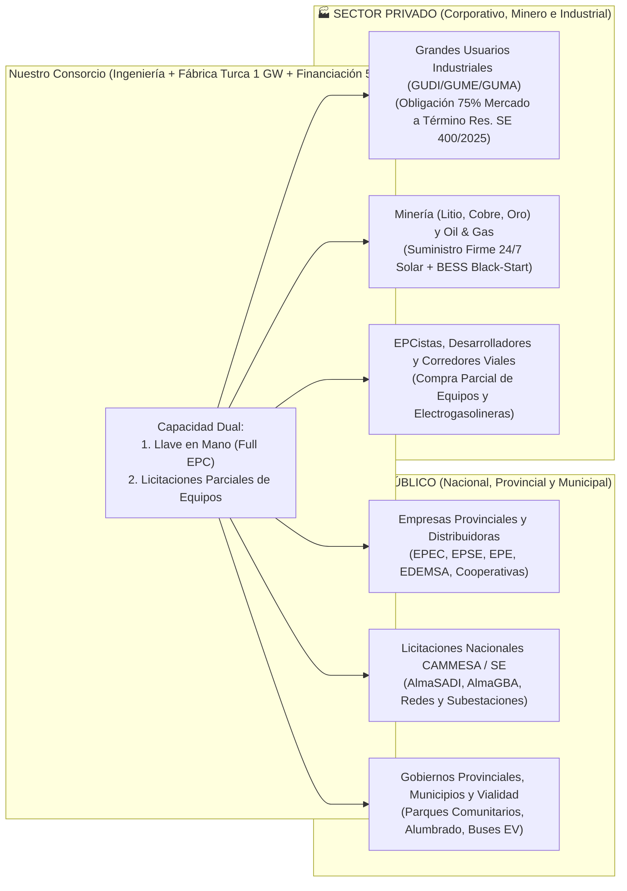

# 🌟 PRESENTACIÓN DE SERVICIOS: SOLUCIONES DE ENERGÍA RENOVABLE, ALMACENAMIENTO BESS, ELECTROMOVILIDAD Y PROVISIÓN DE EQUIPOS PARA ENTES PÚBLICOS Y PRIVADOS

> [!NOTE]
> **VERSATILIDAD DE CONTRATACIÓN: DESDE PROYECTOS INTEGRALES "LLAVE EN MANO" HASTA LICITACIONES PARCIALES DE EQUIPAMIENTO**
> Nuestra organización ofrece una arquitectura comercial y técnica 100% adaptable tanto para **Entes Públicos (Nacionales, Provinciales, Municipales, Distribuidoras y Cooperativas)** como para **Empresas Privadas (Industrias, Mineras, Agroindustria, Desarrolladores y Operadores Logísticos)**. Podemos actuar como **Estructurador y Contratista Integral "Llave en Mano" (Full Turnkey EPC)** o presentarnos de forma independiente a **Licitaciones Parciales de Provisión de Equipos** (paneles solares, inversores, trackers, baterías BESS, subestaciones compactas y cargadores de vehículos eléctricos) con **financiación directa de fábrica de hasta el 50%**.

---

## 🏛️ DIAPOSITIVA 1: QUIÉNES SOMOS Y EL RESPALDO DE NUESTRO SOCIO INDUSTRIAL EN TURQUÍA

Combinamos ingeniería local especializada en el **Sistema Argentino de Interconexión (SADI / CAMMESA)**, estructuración legal-financiera bajo el **RIGI (Ley N.º 27.742)** y una alianza estratégica exclusiva con **uno de los mayores fabricantes de tecnología fotovoltaica y eléctrica de Turquía** *(identidad protegida bajo protocolo de confidencialidad NCNDA)*:

- **38 Años de Trayectoria en Ingeniería Eléctrica y Automatización (Desde 1988)**: Sólida herencia industrial en tableros de media/baja tensión, automatización fabril y equipamiento de potencia, sumada a más de una década de manufactura solar fotovoltaica avanzada.
- **Complejo Industrial Robotizado de $100.000\text{ m}^2$ con Inteligencia Artificial**: Líneas de producción 100% automatizadas con inspección óptica por IA, soldadura *Micro-Gap* y corte láser no destructivo (*NDC*), con una **capacidad de fabricación de $1\text{ GW anual}$ ($1.000\text{ MWp/año}$)**.
- **Centro Corporativo de I+D Acreditado Oficialmente**: Certificado por el Ministerio de Industria y Tecnología de Turquía (Ley N.º 5746), con desarrollos científicos conjuntos junto al Consejo Nacional de Investigación (**TÜBİTAK**).
- **Capacidad de Financiación Directa del 50%**: Respaldo financiero mediante *Vendor Finance / Buyer's Credit* y Agencia de Crédito a la Exportación (**ECA**) para financiar hasta el **50% del proyecto o del suministro de equipos** a largo plazo (hasta 12 años al **5,80% anual en USD**).

---

## 🤝 DIAPOSITIVA 2: MODALIDADES DE TRABAJO CON ENTES PÚBLICOS Y CLIENTES PRIVADOS

### 1. Soluciones para Entes Públicos (Licitaciones Públicas, Iniciativa Privada y PPP)
- **Distribuidoras Provinciales y Cooperativas Eléctricas**: Provisión de parques solares regionales, bancos de baterías **BESS *Grid-Forming*** para estabilizar colas de línea débiles (13,2 kV / 33 kV / 132 kV) y cumplimiento del **75% de contractualización en el Mercado a Término (Decreto PEN 450/2025 y Res. SE 400/2025)**.
- **Ministerios de Infraestructura, Energía y Fideicomisos Mineros**: Presentación a licitaciones públicas (como el modelo **EPSE San Juan**, **Programa BAESA PBA** o **CAMMESA AlmaSADI**) tanto por la obra completa como por lotes específicos de suministro de equipos.
- **Municipios y Entes Viales**: Pabellones de Electrogasolineras públicas, electrificación de flotas de transporte urbano y parques solares comunitarios bajo Generación Distribuida (Ley 27.424).

### 2. Soluciones para el Sector Privado (B2B, MATER, RIGI y Co-Desarrollo)
- **Industrias Electrointensivas y Grandes Usuarios**: Contratos PPA corporativos en el **MATER**, autogeneración en planta (*Behind-the-Meter*) y sistemas BESS para recorte de picos de potencia contratada (*Peak Shaving*).
- **Compañías Mineras y Siderúrgicas**: Centrales híbridas **Solar + BESS 24/7 con arranque en negro (*Black-Start*)** en alta montaña (reemplazando diésel de $>\text{USD } 220/\text{MWh}$) y plantas modulares de **Hidrógeno Verde ($\text{H}_2\text{V}$)** para acero verde libre del arancel europeo **CBAM**.
- **Otros Desarrolladores y Empresas Constructoras (EPCistas)**: Suministro mayorista de equipos (*Supply-Only*) con precios directos de fábrica en Turquía y financiación del 50% para que terceros completen sus propios proyectos.

---

## 📦 DIAPOSITIVA 3: PARTICIPACIÓN EN LICITACIONES PARCIALES DE EQUIPOS Y SUBSISTEMAS

No es necesario contratar el parque completo para acceder a nuestra tecnología y financiación: **nos presentamos a licitaciones parciales, concursos de precios y compras divididas por lotes (*Split-Package Procurement*)** tanto en el ámbito público como privado:

| Lote / Rubro de Licitación Parcial | Equipos y Especificaciones Técnicas que Cotizamos y Suministramos | Ventaja Competitiva en Licitaciones Parciales |
| :--- | :--- | :--- |
| **Lote 1: Módulos Solares Fotovoltaicos** | • **Módulos *N-Type TOPCon* Bifaciales ($550\text{ Wp}$ a $720\text{ Wp+}$)** doble vidrio o vidrio-backsheet. • Arquitectura **SMBB (*Super Multi-Busbar*)** y **MBB**, celdas *Half-Cut* con corte láser no destructivo (*NDC*). • **Paneles Especiales y Arquitectónicos**: Módulos translúcidos para marquesinas (*Solar Carports*), agro-fotovoltaicos y flexibles. | • **Precio directo de fábrica en Turquía ($1\text{ GW/año}$)** sin intermediarios. • Certificación **IEC 61215 / IEC 61730 / CE** y Seguro de Rendimiento Lineal a 25–30 años (*Munich Re / Lloyd's*). • **0% arancel bajo RIGI** y financiación del 50%. |
| **Lote 2: Inversores y Estaciones de Media Tensión (STS)** | • **Inversores *String* de $1.500\text{ V}_{\text{dc}}$ ($100\text{ kW}$ a $350\text{ kW}$)** con múltiples MPPT y diagnóstico inteligente de curvas I-V. • **Inversores de Almacenamiento PCS *Grid-Forming* (Norma IEEE 2800)** con inercia sintética y control reactivo $Q(V)$. • **Centros de Transformación Compactos (*Skid Twin Station* STS de $3.000$ a $9.000\text{ kVA}$)** en $13,2\text{ kV}$ o $33\text{ kV}$. | • Cumplimiento nativo del **Anexo 30 de CAMMESA** (huecos de tensión LVRT/HVRT y regulación primaria de frecuencia). • Entrega pre-cableada *Plug & Play* lista para montaje rápido en campo. |
| **Lote 3: Seguidores Solares (*Trackers*) y Estructuras** | • **Trackers a 1 Eje Horizontal (configuraciones 1P y 2P)** en acero galvanizado en caliente / Magnelis. • Algoritmo de **Backtracking Astronómico 3D** (maximiza producción en terrenos con pendiente y evita sombreado entre filas). • Sistema de puesta en bandera automática (*Wind Stowing*) certificado bajo **Reglamento CIRSOC 102**. | • Adaptación a suelos complejos (hincado directo, pre-perforado o tornillo helicoidal) validada con ensayos de arrancamiento (*Pull-Out Test*). • Estructuras fijas y marquesinas solares para estacionamientos. |
| **Lote 4: Sistemas de Almacenamiento en Baterías (BESS)** | • **Contenedores Modulares $\text{LiFePO}_4$ ($1\text{ MWh}$ a $5\text{ MWh}$ por bloque, 2h a 4h de duración, $\eta_{\text{RTE}} \ge 90\%$)**. • Gestión térmica por **refrigeración líquida**, BMS de 3 niveles y supresión de incendios certificada **NFPA 855 / UL 9540A**. | • Solución ideal para licitaciones de **Reserva de Potencia Firme (AlmaSADI / AlmaGBA)** y estabilización de tensión en distribuidoras. |
| **Lote 5: Tableros de Potencia, Celdas MT, SCADA y Medición SMEC** | • **Tableros de Corriente Continua ($1.500\text{ V}_{\text{dc}}$) y Corriente Alterna**, celdas secundarias GIS/AIS de $13,2 / 33\text{ kV}$. • **Gabinetes de Medición Comercial SMEC Clase 0.2S** y terminales de teleprotección **SOTR** homologados para CAMMESA. • Estaciones meteorológicas Clase A (piranómetros ISO 9060 Spectrally Flat). | • Respaldo directo de los **38 años de experiencia de nuestra fábrica asociada en automatización industrial y tableros eléctricos**. |
| **Lote 6: Cargadores de Vehículos Eléctricos y Pabellones EV** | • **Cargadores Ultra-Rápidos en Corriente Continua (DC $60\text{ kW}$, $180\text{ kW}$ y $360\text{ kW}$)** con conectores CCS2 / NACS. • Cargadores semi-rápidos AC ($7,4\text{ kW}$ a $22\text{ kW}$) para flotas y consorcios. • Plataforma de gestión y cobro inteligente bajo protocolo **OCPP 2.0.1** (cumple **AEA 90364-7-722**). | • Se entregan de forma individual (para estaciones de servicio, municipios o empresas logísticas) o como **Pabellón de Electrogasolinera Llave en Mano** con BESS *buffer*. |

---

## ⚡ DIAPOSITIVA 4: INGENIERÍA DE VALOR — VENTA DE ENERGÍA, VENTA DE POTENCIA Y ESTABILIZACIÓN DE LÍNEAS

Nuestra propuesta técnica y comercial multiplica los ingresos del proyecto y resuelve las restricciones físicas de la red eléctrica:

1. **Subsanación de Irregularidades en las Líneas con BESS *Grid-Forming* (IEEE 2800)**:
   - Las líneas extensas de 33 kV, 132 kV y 500 kV sufren colapsos de tensión cuando superan su **Límite de Impedancia de Onda ($SIL = V_n^2 / Z_c$)** en horas pico, y sobretensiones por **Efecto Ferranti** en horas valle.
   - Nuestros sistemas BESS con inversores *Grid-Forming* inyectan o absorben potencia reactiva dinámica ($Q(V)$ en 4 cuadrantes como un STATCOM las 24 hs), aportan **inercia sintética ($H \ge 4\text{ s}$)** y almacenan el excedente solar del mediodía para eliminar el **8% de recorte (*curtailment*) del MATER Referencial A**.
2. **Doble Flujo de Caja Mayorista: Venta de Energía ($\text{MWh}$) + Venta de Potencia Firme ($\text{USD/MW-mes}$)**:
   - **Venta de Energía Base en MATER Pleno**: Contratos PPA a 10–15 años a **$\text{USD } 62,0/\text{MWh}$** (frente a un costo monómico MEM de $\text{USD } 67\text{–}95/\text{MWh}$).
   - **Venta de Energía en Bloque Pico Nocturno (18:00 a 23:00 hs)**: Despacho de la energía solar almacenada en el BESS a **$\text{USD } 92,0/\text{MWh}$**, desplazando generación térmica a gasoil/GNL que le cuesta al sistema entre **$\text{USD } 120\text{ y } 168/\text{MWh}$**.
   - **Contrato de Venta por Potencia Firme (Esquema CAMMESA AlmaGBA / AlmaSADI)**: Cobro fijo mensual por disponibilidad de potencia firme de **$\text{USD } 10.161\text{ a } 15.000/\text{MW-mes}$** (adoptado en **$\text{USD } 11.500/\text{MW-mes}$**). **Este ingreso fijo cubre por sí solo el 114,8% de toda la cuota anual del financiamiento del 50%**, acelerando radicalmente el retorno de la inversión.

---

## 🚗 DIAPOSITIVA 5: PABELLONES DE ELECTROGASOLINERAS Y ARQUITECTURA FLEXIBLE PARA HIDRÓGENO VERDE ($\text{H}_2\text{V}$)

### 1. Desarrollo de Pabellones de Electrogasolineras ("Solar-to-Wheel")
- Transformamos una fracción de la energía solar propia (costo LCOE de **$\text{USD } 29/\text{MWh}$**) en venta minorista de alta rotación para vehículos eléctricos a **$\text{USD } 340/\text{MWh}$ ($\text{USD } 0,34/\text{kWh}$)**.
- **Triple Beneficio**:
  - **Para el Inversor / Estación de Servicio**: Margen bruto superior al **85%** y **Payback de 1,40 años sobre el capital propio**.
  - **Para el Usuario y Flotas Logísticas**: Tarifa un **30% a 45% más económica que las redes públicas actuales** ($\sim\text{ARS } 580\text{–}798/\text{kWh}$ en YPF Punto Eléctrico) y un **55% más barata por kilómetro recorrido que el gasoil o la nafta**.
  - **Para la Distribuidora Eléctrica**: Cada pabellón incorpora un **BESS *Buffer* local ($1\text{ MWh}$)** que alimenta los cargadores ultra-rápidos de $180\text{–}360\text{ kW}$ sin generar picos de potencia ni caídas de tensión en la red urbana o rural.

### 2. Sistemas Flexibles "H2V-Ready" para Hidrógeno Verde en Argentina y Latinoamérica
- Nuestras subestaciones y parques solares se entregan con **barraje colector en corriente continua ($1.500\text{ V}_{\text{dc}}$ *DC-Coupled Ready*)**, listo para conectar electrolizadores **PEM o Alcalinos** cuando el cliente decida escalar hacia el **Hidrógeno Verde ($\text{H}_2\text{V}$)** y el **Amoníaco Verde ($\text{NH}_3$)**.
- El acoplamiento directo en corriente continua ahorra un **5,5% de pérdidas eléctricas** y un **18% de CAPEX eléctrico**, logrando un costo nivelado **$\text{LCOH} \approx \text{USD } 2,15\text{–}2,45/\text{kg H}_2$** con **0% de retenciones a la exportación a partir del 3.º año bajo el RIGI**.

---

## 📊 DIAPOSITIVA 6: RESUMEN DE RENTABILIDAD AUDITADA CON PRECIOS OFICIALES DEL SISTEMA (2025–2026)

Todos los indicadores están respaldados por datos oficiales de **CAMMESA, Secretaría de Energía, ENRE, ERSeP, Comité RIGI (Ley 27.742), BloombergNEF e IRENA**, incluyendo la **financiación del 50% al 5,80% anual en USD (12 años)**:

| Modalidad de Servicio / Proyecto Tipo | Alcance Público / Privado | CAPEX Total (USD) | Financiación 50% Fábrica (USD) | EBITDA Año 1 (USD) | TIR Proyecto (USD) | TIR Equity (USD) | Payback Proyecto | Payback Equity |
| :--- | :---: | :---: | :---: | :---: | :---: | :---: | :---: | :---: |
| **1. Hub Integral VPU RIGI** *(Solar 250 MWac + BESS 400 MWh + 10 Electrogasolineras + H2V-Ready)* | Privado / Mixto (RIGI) | USD 240,00M | USD 120,00M | **USD 64,56M** *(88,7%)* | **24,48%** | **39,77%** | **3,68 años** | **2,36 años** |
| **2. Licitación Potencia Firme BESS + Solar** *(Esquema CAMMESA AlmaSADI / AlmaGBA: 50 MW/200 MWh BESS + 100 MWac Solar)* | Público / Distribuidoras | USD 89,50M | USD 44,75M | **USD 23,45M** *(88,8%)* | **19,88%** | **31,33%** | **4,33 años** | **2,95 años** |
| **3. Suministro Minero 24/7 Black-Start** *(Solar 150 MWac + BESS 80 MW/320 MWh en NOA/Cuyo)* | Privado Minero / Fideicomiso | USD 142,00M | USD 71,00M | **USD 38,90M** *(88,8%)* | **24,99%** | **40,70%** | **3,62 años** | **2,31 años** |
| **4. Parque Regional Distribuidoras / Cooperativas** *(Res. SE 400/2025: Solar 60 MWac + BESS 20 MW/80 MWh)* | Público / Cooperativas / GUDIs | USD 51,00M | USD 25,50M | **USD 13,10M** *(88,2%)* | **19,35%** | **30,43%** | **4,42 años** | **3,03 años** |
| **5. Red de 20 Pabellones de Electrogasolineras** *(120 Cargadores DC 180-360 kW + 10 MWp FV + 20 MWh BESS)* | Público Vial / Privado Flotas | USD 30,00M | USD 15,00M | **USD 17,54M** *(78,5%)* | **40,76%** | **69,95%** | **2,26 años** | **1,40 años** |
| **6. Licitación Parcial de Equipos (Lote Típico 50 MWp)** *(Provisión de Módulos TOPCon, Trackers, Inversores o BESS)* | Público / Privado (EPCistas) | Desde USD 1,5M a USD 26,0M | **50% Financiado** (5,80% anual USD) | Ahorro directo del **14% al 22%** en CAPEX | — | — | Desembolso diferido a **12 años** | Liberación del 50% de caja del comprador |

---

## 📞 DIAPOSITIVA 7: PROCESO DE CONTRATACIÓN EN 4 PASOS (FAST-TRACK)

1. **Paso 1 — Diagnóstico Técnico-Financiero Sin Cargo (72 hs)**: Evaluación del nodo eléctrico (SADI / Distribuidora), perfil de demanda o pliego de licitación pública/privada (sea por obra completa "Llave en Mano" o por provisión parcial de paneles, inversores, trackers, BESS o cargadores EV).
2. **Paso 2 — Suscripción de Acuerdo NCNDA y Apertura de Carpeta Técnica de Fábrica**: Firma del convenio de confidencialidad, entrega de hojas de datos (*datasheets*), certificados **IEC / TÜV / IEEE 2800**, pólizas de garantía asegurada a 25–30 años y *Term Sheet* de **financiación del 50%**.
3. **Paso 3 — Ingeniería de Detalle, Certificación RTB (58 Ítems) / Oferta Licitatoria y Cierre Financiero**: Presentación de garantías de mantenimiento de oferta, aprobación de estudios eléctricos CAMMESA Anexo 30 / beneficios RIGI y emisión de órdenes de embarque.
4. **Paso 4 — Suministro con Inspección FAT, Construcción EPC, Puesta en Marcha (COD) y O&M**: Entrega auditada en sitio (0% arancel bajo RIGI), comisionamiento bajo norma **IEC 62446** y operación garantizada con disponibilidad $\ge 99,0\%$.
