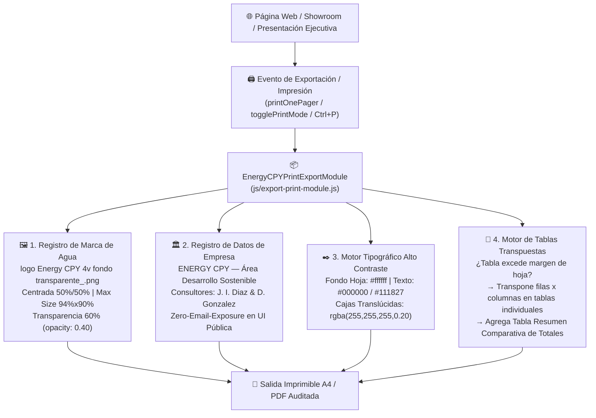

# 🖨️ Módulo de Exportación de Información Imprimible con Registro de Marca de Agua y Datos de la Empresa (`EnergyCPYPrintExportModule`)

## 1. Propósito y Alcance del Módulo
Este documento especifica y registra formalmente el **Módulo Estándar de Exportación e Impresión Ejecutiva (`EnergyCPYPrintExportModule`)** desarrollado para todas las páginas web, presentaciones ejecutivas (`presentacion-servicios-ejecutiva.html`) y resúmenes ejecutivos (*One-Pagers* y *Catálogos de Cartera*) del ecosistema **Energy CPY (`inventarioenergycpy`)**.

El módulo resuelve de forma unificada y determinista cuatro requerimientos críticos de calidad documental:
1. **Registro Oficial de Marca de Agua (`logo Energy CPY 4v fondo transparente_.png`)**: Centrada exactamente al medio de la hoja, escalada al máximo tamaño admisible por los márgenes de página (`width: 94%; height: 90%; object-fit: contain`) y con una **transparecia del 60% (`opacity: 0.40`)**.
2. **Registro Inmutable de Datos Corporativos y Consultores (`COMPANY_REGISTRY`)**: Membrete institucional, dominio oficial, normativa aplicable y datos de contacto de los consultores asignados respetando el protocolo **Zero-Email-Exposure** en vistas públicas para clientes.
3. **Contraste Tipográfico Absoluto sobre Fondo Blanco (`#000000` / `#111827` sobre `#ffffff`)**: Prohibición de grises claros o blancos en modo imprimible y obligatoriedad de contenedores translúcidos (`rgba(255, 255, 255, 0.18)` a `0.25`) para que las tarjetas y tablas no oculten la marca de agua del fondo.
4. **Motor de Transposición Automática de Tablas Anchas (`TRANSPOSED_PRINT_TABLE_ENGINE`)**: Cuando cualquier matriz o tabla comparativa supera el margen horizontal de la hoja a imprimir, el módulo oculta la tabla ancha en la versión imprimible y la reemplaza automáticamente por **tablas individuales transpuestas (filas por columnas) para cada oferta/proyecto** más una **tabla resumen comparativa de los totales al final**.

---

## 2. Arquitectura del Módulo



---

## 3. Registro Oficial de Datos de la Empresa y Marca de Agua (`COMPANY_AND_WATERMARK_REGISTRY`)

Todo agente (`desarrollador-web-showroom`, `analista-financiero`, `gestor-documental-boveda`) que exporte o imprima información desde una página del ecosistema debe inyectar el siguiente registro canónico:

```javascript
const ENERGY_CPY_EXPORT_REGISTRY = {
  company: {
    brandName: "ENERGY CPY",
    division: "Área Desarrollo Sostenible — Private Investment Advisory & Project Finance",
    legalScope: "Estructuración de Proyectos Llave en Mano (EPC), Suministro de Equipos Tier-1 y M&A de Activos Reales",
    country: "República Argentina | Cono Sur Latinoamericano",
    repositories: {
      showroom: "https://inventarioenergycpy.github.io/showroom-energycpy/",
      turnkeyRigi: "https://inventarioenergycpy.github.io/hub-renovable-rigi-llave-en-mano/"
    },
    regulatoryFrameworks: [
      "Ley N.° 27.742 — Régimen de Incentivo para Grandes Inversiones (RIGI - 30 años estabilidad fiscal y cambiaria)",
      "Ley N.° 27.191 / Ley N.° 26.190 — Régimen de Fomento Nacional de Energías Renovables y MATER",
      "Resoluciones SE N.° 67/2025 (AlmaGBA), N.° 50/2026 y N.° 155/2026 (AlmaSADI — Almacenamiento BESS)",
      "Código de Minería de la Nación y Ley N.° 24.196 de Inversiones Mineras"
    ],
    confidentialityNotice_es: "DOCUMENTO ESTRICTAMENTE CONFIDENCIAL — GRADO DE INVERSIÓN. Emitido por Energy CPY con fines de evaluación ejecutiva preliminar. La apertura de Data Room técnico-financiero y revelación de identidades bajo reserva (Blind Teaser) requiere suscripción previa de Acuerdo de Confidencialidad (NDA).",
    confidentialityNotice_en: "STRICTLY CONFIDENTIAL DOCUMENT — INVESTMENT GRADE. Issued by Energy CPY for preliminary executive evaluation. Technical-financial Data Room access and disclosure of Blind Teaser identities require a signed Non-Disclosure Agreement (NDA)."
  },
  watermark: {
    fileName: "logo Energy CPY 4v fondo transparente_.png",
    relativeAssetPath: "assets/images/logo-energy-cpy-4v-transparente.png",
    turnkeyAssetPath: "assets/logo-energy-cpy-4v-transparente.png",
    transparencyPercent: 60, // 60% transparencia = 40% opacidad visual
    cssOpacity: 0.40,
    position: "centered-middle", // top: 50%; left: 50%; transform: translate(-50%, -50%)
    sizing: {
      width: "94%",
      height: "90%",
      maxWidth: "94%",
      maxHeight: "90%",
      objectFit: "contain"
    }
  },
  consultants: {
    javier: {
      id: "javier",
      name: "Javier Ignacio Diaz",
      role_es: "Consultor Especialista — Energía Renovable, BESS, Minería, Agroindustria & Ingeniería",
      role_en: "Specialist Consultant — Renewable Energy, BESS, Mining, Agribusiness & Engineering",
      phoneDisplay: "+54 9 351 2064791",
      phoneClean: "5493512064791",
      whatsappUrl: "https://wa.me/5493512064791"
      // Zero-Email-Exposure en vistas de cliente
    },
    daniel: {
      id: "daniel",
      name: "Daniel Gonzalez",
      role_es: "Consultor Especialista — Petróleo & Gas, Pesca Industrial, Hotelería & Real Estate (REIT)",
      role_en: "Specialist Consultant — Oil & Gas, Industrial Fishing, Hospitality & Real Estate (REIT)",
      phoneDisplay: "+54 9 2974 23-3028",
      phoneClean: "5492974233028",
      whatsappUrl: "https://wa.me/5492974233028"
      // Zero-Email-Exposure en vistas de cliente
    }
  }
};
```

---

## 4. Especificación CSS del Módulo Imprimible (`@media print` & `.print-preview`)

### 4.1. Marca de Agua Centrada al 60% de Transparencia (`opacity: 0.40`)
```css
/* Contenedor de Marca de Agua en cada Hoja Imprimible */
.ecpy-print-watermark,
.slide-watermark,
.one-pager-watermark {
  position: absolute !important;
  top: 50% !important;
  left: 50% !important;
  transform: translate(-50%, -50%) !important;
  width: 94% !important;
  height: 90% !important;
  max-width: 94% !important;
  max-height: 90% !important;
  display: flex !important;
  align-items: center !important;
  justify-content: center !important;
  pointer-events: none !important;
  user-select: none !important;
  z-index: 0 !important;
  border: none !important;
  padding: 0 !important;
}

.ecpy-print-watermark img,
.slide-watermark img,
.one-pager-watermark img {
  width: 100% !important;
  height: 100% !important;
  max-width: 100% !important;
  max-height: 100% !important;
  object-fit: contain !important;
  opacity: 0.40 !important; /* 60% de transparencia solicitada */
  filter: none !important;
  -webkit-print-color-adjust: exact !important;
  print-color-adjust: exact !important;
}
```

### 4.2. Tipografía Negra Oscura (`#000000`) y Contenedores Translúcidos sobre Fondo Blanco (`#ffffff`)
```css
@media print {
  html, body {
    background: #ffffff !important;
    color: #000000 !important;
    -webkit-print-color-adjust: exact !important;
    print-color-adjust: exact !important;
  }

  /* Tarjetas y tablas translúcidas para que la marca de agua del fondo sea siempre visible */
  .card, .op-card-block, .op-deal-bar, .op-metric-box,
  .op-financial-protocol-box, .op-market-card, .op-footer-box,
  .print-transposed-card, .print-summary-totals-card {
    background: rgba(255, 255, 255, 0.20) !important;
    border: 1.5px solid #334155 !important;
    box-shadow: none !important;
    color: #000000 !important;
  }

  /* Tipografía de alto contraste en negro puro y gris carbón oscuro */
  h1, h2, h3, h4, p, li, span, td, th, strong {
    color: #000000 !important;
    text-shadow: none !important;
  }
}
```

---

## 5. Motor de Transposición Automática para Tablas que Exceden el Margen de Hoja

### 5.1. Regla de Diseño
Cuando una tabla comparativa posee múltiples columnas (por ejemplo, $\ge 5$ columnas de indicadores financieros, CAPEX, EBITDA, Payback P50/P90, TIR, Modalidad, Estado) y excede el margen horizontal de la hoja A4 en vista imprimible:
1. **En pantalla (`.screen-only-wide-table`)**: Se mantiene la tabla matricial horizontal para exploración en monitores anchos.
2. **En versión imprimible (`.print-only-transposed-wrapper`)**:
   - Se oculta `.screen-only-wide-table` (`display: none !important`).
   - Se activa `.print-only-transposed-wrapper` (`display: block !important`), que transforma cada fila de la tabla original en una **tabla individual transpuesta** (donde las columnas pasan a ser filas `Parámetro Auditado | Valor del Proyecto/Oferta`), evitando cualquier corte horizontal y permitiendo saltos de página limpios (`break-inside: avoid`).
   - Al final de las tablas individuales, se renderiza obligatoriamente una **Tabla Resumen Comparativa de los Totales** consolidando el portafolio.

### 5.2. Función Generadora Reutilizable (`buildTransposedTablesHtml`)
```javascript
/**
 * Genera el bloque HTML imprimible con tablas individuales transpuestas por oferta/proyecto
 * y una tabla resumen comparativa de totales al final.
 * @param {Array<Object>} items - Lista de ofertas o proyectos a exportar
 * @param {Array<{key: string, label: string, highlight?: boolean}>} schema - Definición de filas transpuestas
 * @param {Object} summaryConfig - Configuración de la tabla resumen comparativa final
 */
function buildTransposedTablesHtml(items, schema, summaryConfig) { ... }
```

---

## 6. Implementaciones Activas en el Ecosistema

| Repositorio / Proyecto | Archivo Implementado | Aplicación del Módulo |
| :--- | :--- | :--- |
| **`hub-renovable-rigi-llave-en-mano`** | [`presentacion-servicios-ejecutiva.html`](file:///C:/Users/majon/.gemini/antigravity-ide/scratch/hub-renovable-rigi-llave-en-mano/presentacion-servicios-ejecutiva.html) | Marca de agua `logo Energy CPY 4v fondo transparente_.png` centrada al 60% de transparencia en las 10 láminas; tipografía negra `#000000`; Lámina 07 con 7 tablas individuales transpuestas P50/P90 + tabla resumen comparativa de totales. |
| **`showroom-energycpy`** | [`js/export-print-module.js`](file:///C:/Users/majon/.gemini/antigravity-ide/scratch/showroom-energycpy/js/export-print-module.js)<br>[`index.html`](file:///C:/Users/majon/.gemini/antigravity-ide/scratch/showroom-energycpy/index.html)<br>[`css/styles.css`](file:///C:/Users/majon/.gemini/antigravity-ide/scratch/showroom-energycpy/css/styles.css)<br>[`js/main.js`](file:///C:/Users/majon/.gemini/antigravity-ide/scratch/showroom-energycpy/js/main.js) | Actualización de la opción **"Imprimir Resumen Ejecutivo"** (tanto por proyecto individual *One-Pager* como el *Resumen Ejecutivo de Cartera de 16 Proyectos*) y del generador PDF [`scripts/generate_catalog_pdf.py`](file:///C:/Users/majon/.gemini/antigravity-ide/scratch/showroom-energycpy/scripts/generate_catalog_pdf.py). |

---

## 🔗 Referencias Relacionales
- [`docs/01-Presentacion-Comercial-Blind-Teaser.md`](file:///C:/Users/majon/.gemini/antigravity-ide/scratch/hub-renovable-rigi-llave-en-mano/docs/01-Presentacion-Comercial-Blind-Teaser.md)
- [`docs/05-Auditoria-Precios-Actuales-y-Stress-Test-Peor-Caso.md`](file:///C:/Users/majon/.gemini/antigravity-ide/scratch/hub-renovable-rigi-llave-en-mano/docs/05-Auditoria-Precios-Actuales-y-Stress-Test-Peor-Caso.md)
- [`presentacion-servicios-ejecutiva.html`](file:///C:/Users/majon/.gemini/antigravity-ide/scratch/hub-renovable-rigi-llave-en-mano/presentacion-servicios-ejecutiva.html)
